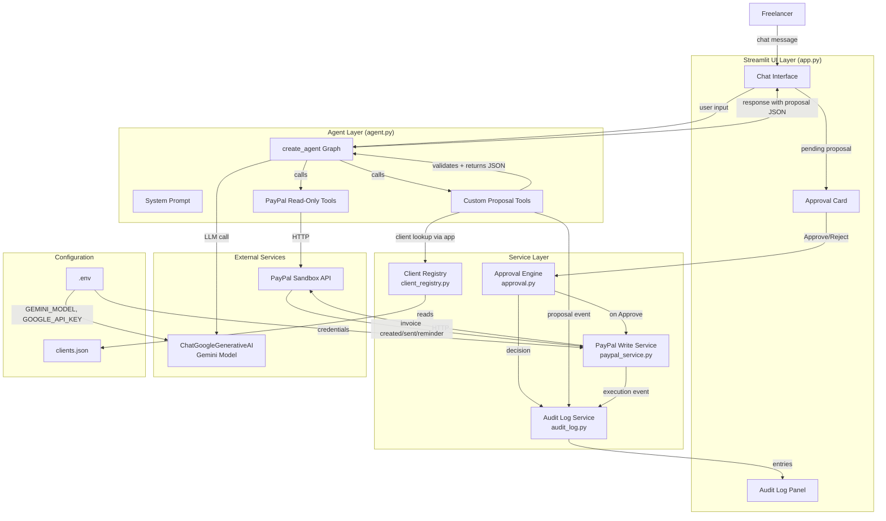
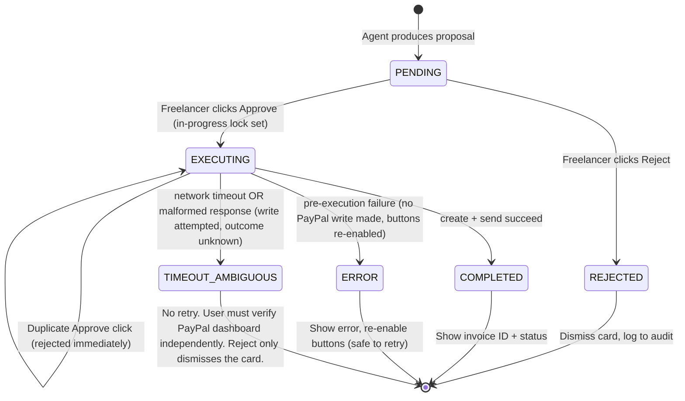
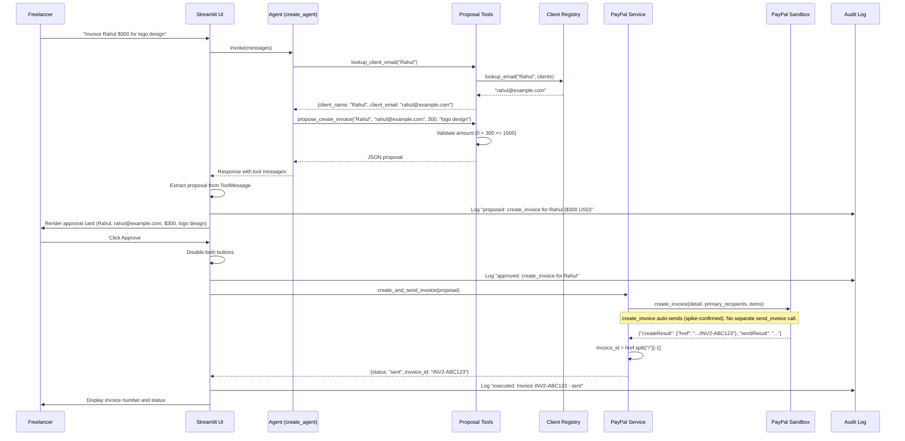
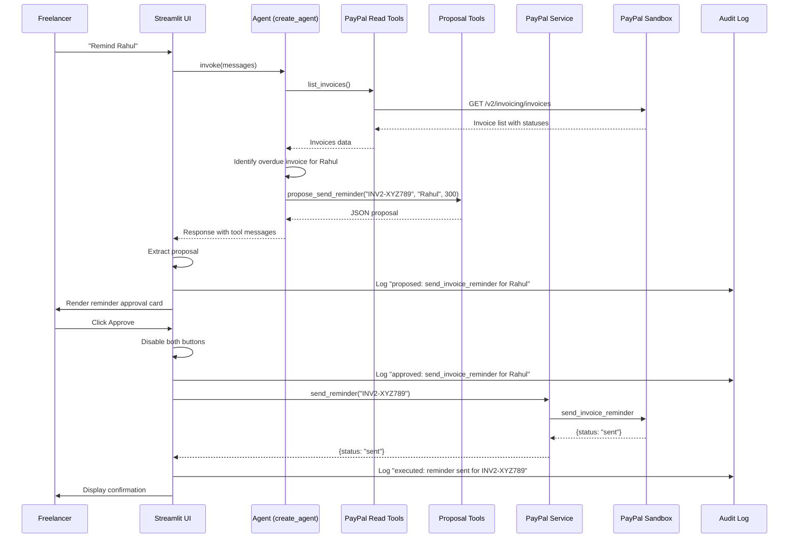
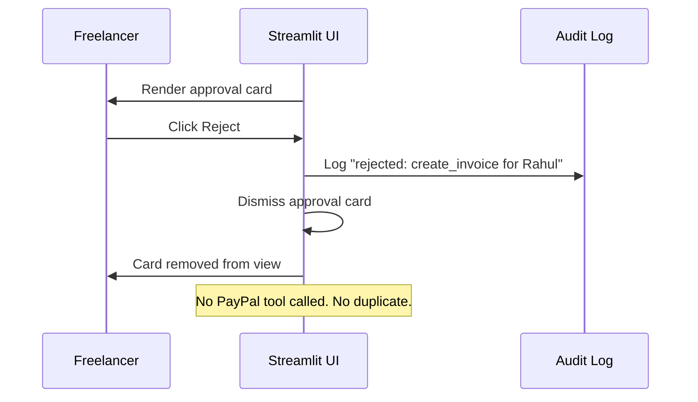
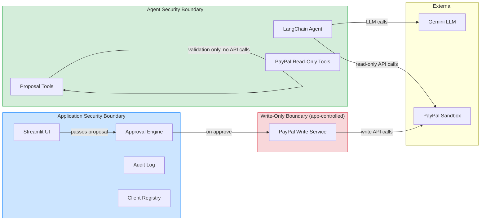
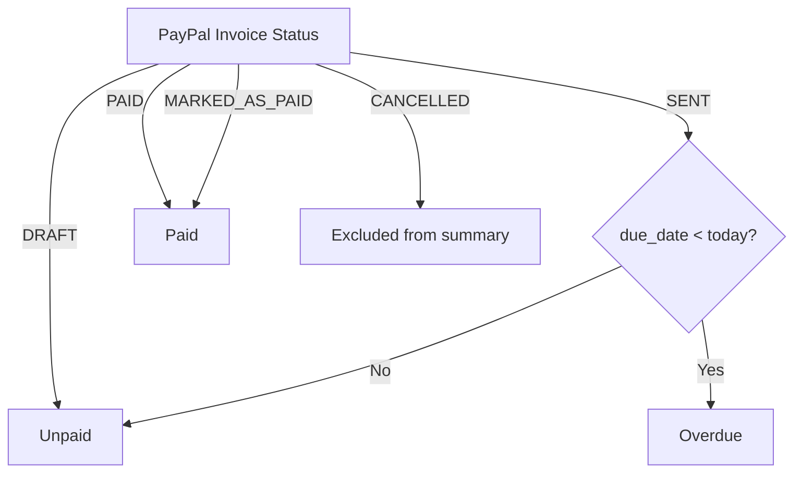

# Design Document

## Overview

This design document describes the technical architecture for InvoicePilot, a chat-based billing agent for freelancers. It translates the approved requirements into concrete component designs, data models, API integration contracts, and testing strategy. The system uses Python, Streamlit, LangChain's `create_agent` with `ChatGoogleGenerativeAI`, and the PayPal Agent Toolkit against the PayPal sandbox.

The core architectural principle is the separation between the LLM agent layer (read-only tools + proposal tools) and the application layer (approval-gated PayPal write operations). The agent can never directly execute a write action. It can only produce structured proposals that the application renders as approval cards. Only when the Freelancer clicks Approve does the application code call the gated PayPal tools.

## Architecture



### Architecture Summary

| Layer | Responsibility | Key Constraint |
|-------|---------------|----------------|
| UI (Streamlit) | Render chat, approval cards, audit log; manage session state | No direct PayPal API calls |
| Agent (LangChain) | Parse natural-language requests, call read-only tools, call client lookup tool (read-only), produce structured proposals | Never receives gated or destructive tools |
| Services | Client lookup, PayPal write execution, audit logging, approval state | Write operations only execute after approval |
| External | Gemini LLM, PayPal sandbox API | External services may fail; UI must remain functional |

## Folder Structure

```
invoicepilot/
├── agent.py              # LangChain create_agent setup, system prompt, tool registration
├── app.py                 # Streamlit UI: chat, approval cards, audit log, session state
├── config.py              # .env loading, constants (AMOUNT_CAP, CURRENCY, model name)
├── models.py              # Pydantic data models: proposals, audit log entries, client record
├── client_registry.py     # clients.json loading and name-to-email lookup
├── paypal_service.py      # App-controlled PayPal write operations (create, send, remind)
├── approval.py            # Approval state machine, validation, execution orchestration
├── audit_log.py           # Audit log entry creation and session-state management
├── tools.py               # Custom LangChain proposal tools (propose_create_invoice, propose_send_reminder)
├── tests/
│   ├── test_amount_cap.py       # PBT: 0 < amount <= 1000, currency == USD
│   ├── test_approval_gate.py    # PBT: no gated tool executes before Approve
│   ├── test_tool_whitelist.py    # PBT: no Never_Exposed_Tool in agent traces
│   ├── test_audit_completeness.py # PBT: every proposed/executed action has log entry
│   ├── test_client_registry.py   # Unit: name-to-email lookup, missing client
│   ├── test_proposal_validation.py # Unit: proposal field validation
│   └── conftest.py               # Shared fixtures, mocks
├── .env.example          # Template with placeholder env vars
├── clients.json.example   # Template with placeholder client entries
├── .gitignore             # Ignores .env, clients.json, __pycache__, etc.
├── requirements.txt       # Pinned dependencies
├── README.md              # Setup, run instructions, required keys
├── LICENSE                # MIT license
└── FEATURES.md            # Text description of features for hackathon submission
```

### Design Rationale

- `agent.py` is the single entry point for the LangChain agent, matching the PRD's naming convention. It imports `create_agent` and `ChatGoogleGenerativeAI`, registers read-only tools and custom proposal tools, and defines the system prompt.
- `app.py` is the Streamlit entry point. It handles all UI rendering, session state, and delegates to services. It never calls PayPal tools directly except through `paypal_service.py` after approval.
- `tools.py` separates custom proposal tools from the agent setup so they can be tested independently.
- `paypal_service.py` is the only component that holds a PayPal toolkit instance with write actions enabled. It is never imported by `agent.py` or `tools.py`.

## Components and Interfaces

### 1. Streamlit UI Layer (`app.py`)

**Responsibility:** Render the chat interface, approval cards, and audit log. Manage session state for conversation history, pending proposals, and audit log entries.

**Key behaviors:**
- Renders a single-page Streamlit app with three sections: chat (top), pending approval card (if any), audit log (bottom or sidebar).
- On user message submission, invokes the LangChain agent graph and streams the response.
- After agent response, scans message history for `ToolMessage` objects from proposal tools (`propose_create_invoice`, `propose_send_reminder`). If found, parses the JSON and stores as `st.session_state["pending_proposal"]`.
- Renders the approval card from the pending proposal. Shows client name, client email, amount (USD), description, and Approve/Reject buttons.
- On Approve: disables both buttons, calls `approval.approve(proposal)`, displays result or error.
- On Reject: dismisses the card, calls `approval.reject(proposal, session_state, audit_log)`, logs to audit. For `timeout_ambiguous` proposals, this sets `proposal_state = "rejected"` to prevent re-execution, but does NOT confirm or cancel the original PayPal operation.
- Renders audit log entries from `st.session_state["audit_log"]`.

**Session state keys:**

| Key | Type | Purpose |
|-----|------|---------|
| `messages` | `list[dict]` | Chat conversation history for LangChain |
| `pending_proposal` | `InvoiceProposal \| ReminderProposal \| None` | P0: single current proposal awaiting decision. P1 extension: replace with `pending_proposals: list` — each reminder in a batch gets its own entry with independent state. |
| `audit_log` | `list[AuditLogEntry]` | All audit log entries for this session |
| `proposal_state` | `str` | State of current proposal: `pending`, `approved`, `rejected`, `executing`, `completed`, `error`, `timeout_ambiguous` |

**Design assumption (OQ-5):** Only one pending proposal at a time. If a new chat message arrives while a proposal is pending, the old proposal is automatically rejected and logged. Clearly marked as a design assumption, not a confirmed product decision.

### 2. Agent Layer (`agent.py`)

**Responsibility:** Build the LangChain agent with `create_agent`, register the system prompt and tool whitelist, and expose an `invoke` interface for the app.

**Agent construction:**

```python
from langchain.agents import create_agent
from langchain_google_genai import ChatGoogleGenerativeAI

# Model from .env
model = ChatGoogleGenerativeAI(model=GEMINI_MODEL)

# Read-only PayPal tools (list_invoices, get_invoice)
read_tools = agent_paypal_toolkit.get_tools()

# Client lookup tool (read-only; prevents LLM from inventing email addresses)
client_lookup_tool = make_client_lookup_tool(load_clients())  # defined in tools.py

# Custom proposal tools (do NOT execute PayPal writes)
proposal_tools = [propose_create_invoice, propose_send_reminder]

# All tools the agent can call (read-only PayPal + client lookup + proposal tools)
all_tools = read_tools + [client_lookup_tool] + proposal_tools

# System prompt (from PRD section 9)
system_prompt = """You are InvoicePilot, a billing assistant for a freelancer.
You can read invoices and propose new invoices or reminders.
You never create, send or remind directly: always return a proposal and
wait for the user to approve it. Use USD only. Never propose an invoice
over $1,000. If the client's email is not known, ask for it before
proposing. Never invent amounts, clients or invoice numbers. When
summarising invoices, report only what the tools returned. If a request
is outside invoicing (refunds, deleting, cancelling), say you can't do
that here."""

agent = create_agent(
    model=model,
    tools=all_tools,
    system_prompt=system_prompt,
)
```

**Key constraints:**
- The agent toolkit configuration enables `{"invoices": {"list": True, "get": True}}` for P0/P1. `get_invoice` is confirmed as a real tool from the official PayPal Agent Toolkit GitHub README. The `get` key is the configuration action name (mirroring the TypeScript example). The exact Python configuration key must be confirmed during the Day 1 spike.
- `get_merchant_insights` is registered only when P2 is enabled (confirmed decision).
- The agent never imports `paypal_service.py` or receives gated tools.
- Proposal tools are custom LangChain tools that validate inputs and return structured JSON. They do not call PayPal APIs.

### 3. Custom Proposal Tools (`tools.py`)

**Responsibility:** Provide LangChain-compatible tools that the agent calls to produce structured proposals. These tools validate inputs but do NOT execute any PayPal operation.

**Tool: `propose_create_invoice`**

```python
from langchain_core.tools import tool
import json

@tool
def propose_create_invoice(
    client_name: str,
    client_email: str,
    amount: float,  # LLM passes float; tool converts to Decimal internally
    description: str,
) -> str:
    """Propose creating a new PayPal invoice. Does NOT create or send the
    invoice. Returns a structured JSON proposal for the user to approve.

    Args:
        client_name: Name of the client to invoice.
        client_email: Email address to send the invoice to.
        amount: Invoice amount in USD. Must be greater than 0 and at most 1000.
        description: Description of the work or service.
    """
    # Validate amount
    if amount <= 0:
        return json.dumps({"error": f"Amount must be greater than 0, got {amount}"})
    if amount > 1000:
        return json.dumps({"error": f"Amount exceeds $1,000 cap, got ${amount}"})
    # Validate email format (basic)
    if "@" not in client_email or "." not in client_email:
        return json.dumps({"error": f"Invalid email: {client_email}"})
    # Build proposal
    from decimal import Decimal, ROUND_HALF_UP
    # Convert to Decimal for exact monetary arithmetic before building proposal
    amount_decimal = Decimal(str(amount)).quantize(Decimal("0.01"), rounding=ROUND_HALF_UP)
    proposal = {
        "action_type": "create_invoice",
        "client_name": client_name,
        "client_email": client_email,
        "amount": str(amount_decimal),  # serialise as string to preserve precision
        "currency": "USD",
        "description": description,
    }
    return json.dumps(proposal)
```

**Tool: `lookup_client_email` (client lookup — read-only)**

```python
@tool
def lookup_client_email(client_name: str) -> str:
    """Look up a client's email address by name in clients.json.
    Returns the email if found, or an error JSON if not found.
    This tool is read-only. It never writes to clients.json.

    Args:
        client_name: The exact name of the client to look up.
    """
    clients = load_clients()
    email = clients.get(client_name)
    if email is None:
        return json.dumps({"error": f"Client not found: {client_name}. Please ask the user for the email address."})
    return json.dumps({"client_name": client_name, "client_email": email})
```

**Design note:** Registering `lookup_client_email` as an agent tool resolves the architecture inconsistency where the flowchart showed `AgentGraph --> ClientReg` but the agent tool list had no such tool. The LLM calls this tool to retrieve the email rather than inventing it. The tool is read-only and never creates or updates client records.

**Tool: `propose_send_reminder`**

```python
@tool
def propose_send_reminder(
    invoice_id: str,
    client_name: str,
    amount_due: float,
    proposed_note: str = "",
) -> str:
    """Propose sending a payment reminder for an overdue invoice.
    Does NOT send the reminder. Returns a structured JSON proposal.

    Args:
        invoice_id: PayPal invoice ID of the overdue invoice.
        client_name: Name of the client.
        amount_due: Amount still owed on the invoice.
        proposed_note: Optional message shown to the Freelancer on the approval
            card. This is a PREVIEW only. Whether PayPal sends a custom note is
            unverified — see paypal_service.send_reminder for details.
    """
    from decimal import Decimal, ROUND_HALF_UP
    amount_decimal = Decimal(str(amount_due)).quantize(Decimal("0.01"), rounding=ROUND_HALF_UP)
    proposal = {
        "action_type": "send_invoice_reminder",
        "invoice_id": invoice_id,
        "client_name": client_name,
        "amount_due": str(amount_decimal),
        "proposed_note": proposed_note,
    }
    return json.dumps(proposal)
```

**Design assumption (OQ-3):** Reminder proposals show invoice ID, client name, amount due, and a proposed reminder note. The note is agent-generated based on the invoice context. Marked as design assumption, not confirmed.

**Design assumption (OQ-9):** If description is missing from the user's request, the system prompt instructs the agent to ask for one before calling `propose_create_invoice`. Marked as design assumption.

**Proposal extraction in app code:**

```python
from langchain_core.messages import ToolMessage

def extract_proposal(result):
    """Scan agent result for the latest proposal tool call."""
    for msg in reversed(result["messages"]):
        if isinstance(msg, ToolMessage):
            if msg.name in ("propose_create_invoice", "propose_send_reminder"):
                data = json.loads(msg.content)
                if "error" not in data:
                    return data  # structured proposal dict
    return None
```

## Data Models

The following Pydantic models define the structured data used across the application:

```python
from decimal import Decimal
from pydantic import BaseModel, Field, field_validator
from datetime import datetime
from typing import Literal, Optional
from uuid import uuid4

AMOUNT_CAP = 1000.00
CURRENCY = "USD"

class InvoiceProposal(BaseModel):
    """Structured proposal for creating and sending a PayPal invoice."""
    proposal_id: str = Field(default_factory=lambda: str(uuid4()))
    action_type: Literal["create_invoice"]
    client_name: str = Field(min_length=1)
    client_email: str = Field(min_length=3)
    amount: Decimal = Field(gt=0, le=AMOUNT_CAP)
    currency: str = Field(default="USD")
    description: str = Field(min_length=1)

    @field_validator("client_email")
    @classmethod
    def validate_email(cls, v: str) -> str:
        import re
        # RFC 5322 simplified pattern: local@domain.tld
        if not re.match(r"^[^@\s]+@[^@\s]+\.[^@\s]+$", v):
            raise ValueError(f"Invalid email format: {v}")
        return v.lower().strip()

    @field_validator("currency")
    @classmethod
    def validate_currency(cls, v: str) -> str:
        if v != "USD":
            raise ValueError(f"Currency must be USD, got {v}")
        return v

class ReminderProposal(BaseModel):
    """Structured proposal for sending a payment reminder."""
    proposal_id: str = Field(default_factory=lambda: str(uuid4()))
    action_type: Literal["send_invoice_reminder"]
    invoice_id: str = Field(min_length=1)
    client_name: str = Field(min_length=1)
    amount_due: Decimal = Field(gt=0)
    # proposed_note is what the Freelancer SEES on the approval card.
    # It is NOT necessarily sent to PayPal — see reminder_contract_note below.
    proposed_note: Optional[str] = None

class AuditLogEntry(BaseModel):
    """A single audit log entry recording a proposed, approved, rejected,
    executed, or error event. All events for the same proposal share
    the same proposal_id, enabling full audit trail correlation.
    Note: audit history exists in session state only — not durable across page refreshes."""
    timestamp: datetime
    proposal_id: Optional[str] = None  # correlates all events for the same proposal
    action_type: Literal[
        "proposed", "approved", "rejected", "executed", "error"
    ]
    description: str
    result: Optional[str] = None  # success message or error text

class ClientRecord(BaseModel):
    """A single client entry in clients.json."""
    name: str
    email: str
```

### 5. Client Registry Service (`client_registry.py`)

**Responsibility:** Load `clients.json` and provide name-to-email lookup.

**Design decision (OQ-1):** The JSON structure is a flat dictionary mapping names to emails: `{"Rahul": "rahul@example.com"}`. Lookup is case-sensitive exact match. This is the simplest approach consistent with the PRD and suitable for a hackathon demo.

```python
import json

def load_clients() -> dict[str, str]:
    """Load clients.json as a {name: email} dict."""
    with open("clients.json", "r") as f:
        return json.load(f)

def lookup_email(name: str, clients: dict[str, str]) -> str | None:
    """Look up a client email by exact name match (case-sensitive)."""
    return clients.get(name)
```

**Error handling:** If `clients.json` is missing, raise a clear error at startup. If a name is not found, return `None` and the agent asks for the email.

### 6. PayPal Integration Service (`paypal_service.py`)

**Responsibility:** Hold the second PayPal toolkit instance (with write actions enabled) and execute gated operations after approval. This is the ONLY component with write-tool access.

**Toolkit configuration:**

```python
from paypal_agent_toolkit.langchain.toolkit import PayPalToolkit
from paypal_agent_toolkit.common.configuration import Configuration, Context

write_config = Configuration(
    actions={
        "invoices": {
            "create": True,       # create_invoice auto-sends (spike-confirmed)
            "sendReminder": True, # send_invoice_reminder for reminders
            # send: True omitted — create_invoice already sends; separate send
            # would dispatch a duplicate. Enable only if DRAFT→SENT needed.
            # Never enabled: cancel, generateQRC, and all order/subscription tools.
            # delete_invoice does not exist in paypal-agent-toolkit==1.1.0.
        }
    },
    context=Context(sandbox=True),
)

write_toolkit = PayPalToolkit(
    client_id=PAYPAL_CLIENT_ID,
    secret=PAYPAL_SECRET,
    configuration=write_config,
)
write_tools = {tool.name: tool for tool in write_toolkit.get_tools()}
```

**Execution functions:**

```python
def create_and_send_invoice(proposal: InvoiceProposal) -> dict:
    """Create and send a PayPal invoice in a single call.

    SPIKE-CONFIRMED (spike_results.md section 3.3):
    - create_invoice auto-calls send_invoice internally. Do NOT call
      send_invoice separately — it would send the invoice a second time.
    - recipient email goes in primary_recipients[0].billing_info.email_address,
      NOT as a top-level 'recipient_email' field.
    - quantity must be a string, not int.
    - unit_amount uses 'currency_code' (not 'currency') and string values.
    - Invoice ID is parsed from createResult.href, not from result['id'].
    """
    import json as _json

    create_result_str = write_tools["create_invoice"].invoke({
        "detail": {"currency_code": str(proposal.currency)},
        "primary_recipients": [{
            "billing_info": {
                "email_address": proposal.client_email,
            }
        }],
        "items": [{
            "name": proposal.description,
            "quantity": "1",                        # string, confirmed by spike
            "unit_amount": {
                "currency_code": str(proposal.currency),
                "value": str(proposal.amount),      # string repr of Decimal
            },
        }],
    })

    # Tool returns a JSON string; parse it
    try:
        create_result = _json.loads(create_result_str)
    except (TypeError, ValueError):
        return {"status": "malformed_response", "error": f"Malformed response: {create_result_str}"}

    # Validate expected structure before accessing nested fields
    if not isinstance(create_result, dict) or "createResult" not in create_result:
        return {"status": "malformed_response", "error": f"Unexpected response structure: {create_result}"}

    create_inner = create_result["createResult"]
    if not isinstance(create_inner, dict) or "href" not in create_inner:
        return {"status": "malformed_response", "error": f"Missing href in createResult: {create_result}"}

    # Parse invoice ID from href (spike_results.md section 3.2)
    invoice_id = create_inner["href"].split("/")[-1]

    # create_invoice already sent — no separate send_invoice call
    return {
        "status": "sent",
        "invoice_id": invoice_id,
    }

def send_reminder(invoice_id: str, proposed_note: str | None = None) -> dict:
    """Send a payment reminder for an existing invoice.

    SPIKE-CONFIRMED (spike_results.md section 3.5):
    send_invoice_reminder accepts an optional 'note' field.
    proposed_note from ReminderProposal is safe to pass directly.
    """
    import json as _json

    payload: dict = {"invoice_id": invoice_id}
    if proposed_note:
        payload["note"] = proposed_note   # confirmed supported by spike

    result_str = write_tools["send_invoice_reminder"].invoke(payload)

    try:
        result = _json.loads(result_str) if isinstance(result_str, str) else result_str
    except (TypeError, ValueError):
        result = result_str

    if isinstance(result, dict) and "error" in result:
        return {"status": "error", "error": str(result)}

    return {"status": "sent", "result": result}
```

**Key safety guarantees:**
- `paypal_service.py` is never imported by `agent.py` or `tools.py`.
- The write toolkit configuration explicitly omits `cancel`, `delete`, `record_refund`, and `record_payment`.
- All functions revalidate the proposal before execution (amount cap, currency, email format).

### 7. Approval Engine (`approval.py`)

**Responsibility:** Manage the approval state machine, revalidate proposals before execution, and orchestrate the create-and-send flow with partial failure handling.

**State machine:**



**Approval flow:**

```python
def approve(proposal, session_state, audit_log):
    """Execute the approved proposal through PayPal service.

    Guards:
    - Duplicate rejection: if proposal_state is in any terminal or in-flight state
      (executing, completed, timeout_ambiguous, rejected), the call is rejected
      immediately without touching PayPal.
    - In-progress lock: proposal_state is set to 'executing' before any PayPal
      call, so a second Approve click (double-click race) is blocked.
    """
    # Duplicate / in-progress guard
    current_state = session_state.get("proposal_state", "pending")
    # Block re-execution for all terminal or in-flight states.
    # timeout_ambiguous is explicitly blocked: the PayPal outcome is unknown
    # and a second Approve could create a duplicate invoice.
    # rejected is blocked: a Reject dismisses the proposal permanently;
    # any new action requires a fresh proposal from a new chat request.
    if current_state in ("executing", "completed", "timeout_ambiguous", "rejected"):
        return {"status": "duplicate_rejected",
                "error": f"Cannot approve: proposal is in state '{current_state}'."}

    # Set in-progress flag before any PayPal call
    session_state["proposal_state"] = "executing"

    # Revalidate before execution (defense in depth)
    validated = revalidate(proposal)
    if not validated.ok:
        session_state["proposal_state"] = "error"
        add_entry(audit_log, "error",
                  f"Revalidation failed: {validated.error}",
                  proposal_id=proposal.proposal_id)
        return {"status": "error", "error": validated.error}

    add_entry(audit_log, "approved",
              f"Approved: {proposal.action_type}",
              proposal_id=proposal.proposal_id)

    if proposal.action_type == "create_invoice":
        result = paypal_service.create_and_send_invoice(proposal)
    elif proposal.action_type == "send_invoice_reminder":
        result = paypal_service.send_reminder(proposal.invoice_id)

    if result["status"] == "sent":
        session_state["proposal_state"] = "completed"
        add_entry(audit_log, "executed",
                  f"Executed: {proposal.action_type}",
                  result=f"Invoice {result.get('invoice_id', '')} - sent",
                  proposal_id=proposal.proposal_id)
    elif result["status"] == "timeout_ambiguous":
        # Network timeout — PayPal write was attempted, outcome unknown.
        # Non-retryable: a second Approve could create a duplicate invoice.
        session_state["proposal_state"] = "timeout_ambiguous"
        add_entry(audit_log, "error",
                  f"Timeout: outcome unknown for {proposal.action_type}",
                  result="Check PayPal sandbox dashboard. Reject only dismisses the card; it does not resolve the PayPal transaction.",
                  proposal_id=proposal.proposal_id)
    elif result["status"] == "malformed_response":
        # PayPal write was attempted but the response could not be parsed.
        # The invoice may or may not have been created and sent.
        # Non-retryable: a second Approve could create a duplicate invoice.
        session_state["proposal_state"] = "timeout_ambiguous"
        add_entry(audit_log, "error",
                  f"Malformed response from PayPal for {proposal.action_type}",
                  result="Outcome unknown — check PayPal sandbox dashboard. Reject only dismisses; it does not resolve the transaction.",
                  proposal_id=proposal.proposal_id)
    else:
        # "error" — definite pre-execution failure (auth, validation, revalidation).
        # No PayPal write was attempted. Safe to re-enable buttons for retry.
        session_state["proposal_state"] = "error"
        add_entry(audit_log, "error",
                  f"Execution failed: {proposal.action_type}",
                  result=result.get("error"),
                  proposal_id=proposal.proposal_id)

    return result

def reject(proposal, session_state, audit_log):
    """Dismiss the proposal and log the rejection.

    Always sets proposal_state to "rejected" regardless of the prior state.
    This prevents a timeout_ambiguous proposal from being silently retried:
    after Reject, the guard in approve() will block any further Approve click.

    IMPORTANT for timeout_ambiguous: Reject only dismisses the UI card.
    It does NOT establish whether PayPal created or sent the invoice.
    The user must verify the PayPal sandbox dashboard independently.
    Any subsequent billing action must use a fresh proposal from a new chat request.
    """
    session_state["proposal_state"] = "rejected"
    add_entry(audit_log, "rejected",
              f"Rejected: {proposal.action_type}",
              proposal_id=proposal.proposal_id)
    return {"status": "rejected"}
```

**Failure mode handling:**

**A. Definite failure before any external operation** (revalidation fails, auth error before first API call):
- No PayPal state has changed. Set `proposal_state = "error"`. Re-enable both buttons so the user can retry.

**B. Malformed or unexpected response from `create_invoice` (after a PayPal write was attempted):**
- `create_invoice` auto-sends internally. If the response cannot be parsed or lacks `createResult.href`, a PayPal write was already attempted and the outcome is unknown. Set `proposal_state = "timeout_ambiguous"` (NOT `"error"`, because retrying could create a duplicate invoice). Keep Approve disabled. Log the raw response as an error. Reject only dismisses the UI card — it does NOT resolve or cancel the PayPal transaction. A new proposal is allowed only after the user independently verifies and resolves the original PayPal outcome.

**C. Network timeout (ambiguous outcome):**
- The outcome is unknown — PayPal may or may not have completed the operation. Set `proposal_state = "timeout_ambiguous"`. Keep Approve disabled. Never auto-retry. Display: "Request timed out. Check your PayPal sandbox dashboard before trying again."
- **PayPal idempotency note (unverified):** PayPal REST APIs support `PayPal-Request-Id` for idempotency at the HTTP layer. The `paypal-agent-toolkit` does not expose this header through its tool interface. Until the spike confirms otherwise, treat timeouts as ambiguous and never auto-retry.

**Retry rules (by proposal_state):**
- `error`: definite pre-execution failure — re-enable Approve and Reject, user may correct and retry.
- `completed`: no retry. Approve and Reject stay disabled.
- `executing`: no retry (in-progress guard active).
- `timeout_ambiguous`: no auto-retry. User must verify in PayPal dashboard, then click Reject to dismiss and start fresh.
- `rejected`: proposal is dismissed; a new chat request generates a fresh proposal.

### 8. Audit Logging (`audit_log.py`)

**Responsibility:** Create and manage audit log entries in session state.

**Design decision (OQ-6):** The audit log is in-memory session state only (`st.session_state["audit_log"]`). It is lost on page refresh. No file persistence. This is consistent with the PRD's "no database" and "on-screen audit log" constraints.

```python
from datetime import datetime, timezone

def add_entry(
    audit_log: list,
    action_type: str,
    description: str,
    result: str | None = None,
    proposal_id: str | None = None,
):
    """Append an entry to the audit log.

    proposal_id correlates all events (proposed, approved, rejected, executed,
    error) that belong to the same proposal. Pass it for every call after the
    proposal is created so the full audit trail for a single action is linkable.

    The audit log lives in st.session_state only. It is NOT durable across
    Streamlit page refreshes or server restarts. This is by design (PRD: no database).
    """
    entry = AuditLogEntry(
        timestamp=datetime.now(timezone.utc),
        proposal_id=proposal_id,
        action_type=action_type,
        description=description,
        result=result,
    )
    audit_log.append(entry)
```

**Audit log entry types:**

| action_type | When | proposal_id | Description example |
|-------------|------|-------------|---------------------|
| `proposed` | Agent produces a proposal | set | "Proposed: create_invoice for Rahul ($300 USD)" |
| `approved` | Freelancer clicks Approve | same | "Approved: create_invoice for Rahul" |
| `rejected` | Freelancer clicks Reject | same | "Rejected: create_invoice for Rahul" |
| `executed` | PayPal operation succeeds | same | "Executed: create_invoice - Invoice INV2-ABC123 - sent" |
| `error` | PayPal operation fails or revalidation fails | same | "Error: create_invoice failed - auth error" |

## Error Handling

**Error handling matrix:**

| Error scenario | Detection | UI behavior | Audit log |
|---------------|-----------|-------------|-----------|
| Unknown client | `lookup_email` returns `None` | Agent asks for email | Not logged (normal flow) |
| Amount missing/zero/negative | Proposal tool validation | Agent requests valid amount | Not logged (normal flow) |
| Amount over $1,000 cap | Proposal tool validation | Agent refuses, cap message shown | Not logged (normal flow) |
| Non-USD currency | System prompt + proposal validation | Agent refuses | Not logged (normal flow) |
| PayPal auth error | PayPal toolkit returns error | Readable error message | Logged as `error` |
| Invoicing not enabled | PayPal toolkit returns error | Readable error message | Logged as `error` |
| PayPal validation error | PayPal toolkit returns error | Readable error message | Logged as `error` |
| Gemini error/rate limit | Exception from ChatGoogleGenerativeAI | Retry message, UI stays functional | Logged as `error` |
| create_invoice returns malformed/unexpected response | JSON parse + structure validation in `create_and_send_invoice` | Error shown, outcome uncertain, Approve disabled | Logged as `error` |
| Network timeout during create_invoice (outcome unknown) | Timeout caught in `create_and_send_invoice` | Warning shown, Approve disabled, no auto-retry, user checks PayPal dashboard | Logged as `error` with status `timeout_ambiguous` |
| Double-click Approve | Button disabled on first click | Second click ignored | N/A |
| Prompt injection in description | Tool whitelist limits tools | Agent cannot escalate | N/A (whitelist is the mitigation) |

**Gemini retry (OQ-10, design assumption):** On Gemini error or rate limit, display a retry message and allow the user to resend the last chat message manually. No automatic retry with backoff. This is the simplest approach for a hackathon demo.

**Design assumption (OQ-10):** Manual retry only, no automatic backoff. Marked as design assumption.

## Sequence Diagrams

### Invoice Creation Flow



### Reminder Flow



### Rejection Flow



## API Integration Contracts

### PayPal Agent Toolkit Configuration

**Two separate toolkit instances:**

| Instance | Used by | Actions enabled | Purpose |
|----------|---------|-----------------|---------|
| Agent toolkit | `agent.py` | `{"invoices": {"list": True, "get": True}}` | Read-only: list invoices, get single invoice |
| Write toolkit | `paypal_service.py` | `{"invoices": {"create": True, "sendReminder": True}}` | Gated: create+send invoice (single call), send reminder after approval |

**Never enabled in either toolkit:** `cancel`, `delete`, `record_refund`, `record_payment`, and all order/subscription/dispute/product actions.

**Import paths (verified from PayPal documentation):**
- `from paypal_agent_toolkit.langchain.toolkit import PayPalToolkit`
- `from paypal_agent_toolkit.common.configuration import Configuration, Context`

**Configuration pattern:**
```python
configuration = Configuration(
    actions={"invoices": {"list": True}},
    context=Context(sandbox=True),
)
toolkit = PayPalToolkit(
    client_id=PAYPAL_CLIENT_ID,
    secret=PAYPAL_SECRET,
    configuration=configuration,
)
tools = toolkit.get_tools()  # Returns list[BaseTool]
```

### PayPal Tool Schemas (from agent tools reference)

**`create_invoice` (spike-confirmed — auto-sends, no separate send_invoice needed):**
- `detail.currency_code` (string, required): e.g. `"USD"`
- `primary_recipients[0].billing_info.email_address` (string): recipient email (NOT `recipient_email`)
- `items[].name` (string): item description
- `items[].quantity` (string, not int): e.g. `"1"`
- `items[].unit_amount.currency_code` (string): e.g. `"USD"`
- `items[].unit_amount.value` (string): e.g. `"300.00"`
- **Return:** JSON string with `{"createResult": {"href": "...invoices/INV2-XXXX", ...}, "sendResult": "..."}`
- **Invoice ID extraction:** `result["createResult"]["href"].split("/")[-1]`

**`list_invoices`:**
- No required parameters. Returns list of invoices with IDs, statuses, amounts, due dates.

**`send_invoice`:**
- `invoice_id` (string, required): The PayPal invoice ID to send

**`send_invoice_reminder` (spike-confirmed):**
- `invoice_id` (string, required): The PayPal invoice ID to remind
- `note` (string, optional): Custom note — CONFIRMED supported (spike_results.md section 3.5)

**Unverified assumptions:**
- The exact action key names in the configuration dict (e.g., `"sendReminder"` vs `"send_reminder"`). The Vercel TypeScript example uses `"sendReminder"`. The Python package may use the same or different keys. Needs verification during spike.
- The exact parameter names and return formats of each tool. The PayPal agent tools reference describes the API-level parameters, but the toolkit may wrap them differently. Needs verification during spike.
- **[CONFIRMED]** `get_invoice` exists as a distinct tool. The exact Python configuration action key (`"get"` vs `"show"`) must be confirmed during the Day 1 spike by printing `toolkit.get_tools()` names.

### LangChain Agent Configuration

**Import:** `from langchain.agents import create_agent`

**Model:** `ChatGoogleGenerativeAI(model=os.getenv("GEMINI_MODEL"))`

**Structured output:** `ChatGoogleGenerativeAI` supports `with_structured_output(schema, method="json_schema")` with Pydantic models. This is used within proposal tools for validation, not at the agent level (the agent needs to both call tools and return chat messages).

**Agent invocation pattern:**
```python
result = agent.invoke({
    "messages": st.session_state["messages"]
})
# result["messages"] contains the full message list including
# HumanMessage, AIMessage, ToolMessage objects
```

## Security Boundaries



**Security rules:**
1. The agent boundary (green) only contains read-only tools and proposal tools. No write or destructive tools.
2. The write boundary (red) is only accessible through the approval engine after explicit user approval.
3. The agent never imports `paypal_service.py`. This is enforced by code structure, not just configuration.
4. Destructive tools (`delete`, `cancel`, `record_refund`, `record_payment`) are never enabled in any toolkit configuration.
5. Credentials are loaded from `.env` at startup and never logged or exposed to the agent.
6. The tool whitelist is the primary mitigation for prompt injection: even if a malicious description tricks the agent, the agent cannot call write tools.

## Correctness Properties

The following correctness properties are P0 and must be verified with property-based testing (Hypothesis):

### Property 1: Amount_Cap_and_Currency invariant (Req 2) — P0

**Validates: Requirements 2.1, 2.3, 2.6**

For all InvoiceProposals, the validated amount satisfies `0 < amount <= 1000.00` and currency equals USD. Tested by generating random amounts and verifying the validation function rejects invalid ones and accepts valid ones.

### Property 2: Approval_gate invariant (Req 3) — P0

**Validates: Requirements 3.3, 3.5, 3.6**

No gated PayPal tool executes before the Approve button is clicked exactly once. Tested by generating random interaction sequences and verifying mocked PayPal write tools are only called after exactly one Approve click.

### Property 3: Tool_whitelist conformance (Req 5) — P0

**Validates: Requirements 5.1, 5.5, 5.6**

No Never_Exposed_Tool appears in the agent's tool list. Tested by asserting the tool list contains only expected tool names and excludes all destructive tools.

### Property 4: Audit_Log completeness (Req 6) — P0

**Validates: Requirements 6.1, 6.2, 6.5**

Every proposed action and every executed action has a corresponding Audit_Log entry. Tested by generating random sequences of proposals, approvals, rejections, and executions, then verifying each has a matching log entry.

## Testing Strategy

### Property-Based Tests (P0 — all four confirmed)

**Framework:** Hypothesis (Python property-based testing library)

**1. Amount_Cap_and_Currency invariant (Req 2):**
- Generate random float amounts (including negatives, zero, > 1000, edge cases like 1000.01, 999.99)
- Assert: after validation, `0 < amount <= 1000.00` and `currency == "USD"`
- Test the proposal tool's validation logic directly (no PayPal calls)

**2. Approval_gate invariant (Req 3):**
- Generate random sequences of interactions (no approve, approve once, approve twice)
- Assert: no gated PayPal tool is invoked unless Approve is clicked exactly once
- Mock the PayPal write tools; verify call counts

**3. Tool_whitelist conformance (Req 5):**
- Assert: the agent's tool list contains only `list_invoices` (and `get_invoice` if available) + proposal tools
- Assert: no tool name matches any Never_Exposed_Tool name
- This is a static configuration check, not a dynamic trace

**4. Audit_Log completeness (Req 6):**
- Generate random sequences of proposals, approvals, rejections, executions
- Assert: every proposal has a `proposed` entry, every approval has an `approved` entry, every rejection has a `rejected` entry, every execution has an `executed` or `error` entry

**5. Duplicate execution protection — P0:**
- Generate random sequences with multiple Approve clicks on the same proposal (simulating double-click or network retry)
- Assert: the gated PayPal tool is called at most once per proposal_id regardless of how many Approve signals are sent
- Mock the PayPal write tools; verify call counts per proposal_id

**6. Ambiguous PayPal outcome — P0:**
- Simulate a network timeout response from the mocked PayPal write tool
- Assert: the system records `status: "timeout_ambiguous"` in the audit log
- Assert: no automatic retry is issued after a timeout
- Assert: the proposal_state transitions to `"timeout_ambiguous"` (not `"error"` or `"completed"`), keeping Approve disabled

### Unit Tests

- `test_client_registry.py`: name-to-email lookup, missing client, empty registry
- `test_proposal_validation.py`: amount validation, email format, currency enforcement
- `test_approval.py`: state transitions, partial failure handling, reject behavior

### Integration Tests (not PBT)

- PayPal sandbox end-to-end: create invoice, send, verify status (1-2 examples)
- Reminder flow: list overdue invoices, send reminder (1 example)
- These require live PayPal sandbox credentials and are marked as `@pytest.mark.integration`

### Test isolation:
- PBT and unit tests use mocked PayPal tools — no real API calls
- Integration tests are skipped unless credentials are available

## Design Assumptions (Open Question Resolutions)

The following design assumptions resolve open questions provisionally. They are clearly marked as assumptions and are NOT confirmed product decisions. The requirements document retains these as open questions.

| OQ | Assumption | Status |
|----|-----------|--------|
| OQ-1 | `clients.json` is a flat `{"name": "email"}` dict. Case-sensitive exact match. No fuzzy matching. | Design assumption |
| OQ-2 | Status mapping defined in design: `unpaid = SENT/DRAFT not yet paid`, `overdue = SENT + due_date < today`, `paid = PAID`. CANCELLED excluded. | Design assumption |
| OQ-3 | Reminder proposal shows invoice ID, client name, amount due, and proposed reminder note (agent-generated). | Design assumption |
| OQ-5 | P0: One pending proposal at a time. New chat message auto-rejects any pending proposal. P1 batch reminders: each overdue invoice produces an independent proposal with its own proposal_id, proposal_state, and approval decision. The extract_proposal logic must NOT silently discard all but the latest proposal when multiple reminders are present — it must maintain a list of pending proposals for P1. | Design assumption |
| OQ-6 | Audit log is in-memory session state only. No file persistence. Fields: timestamp, action_type, description, result. | Design assumption |
| OQ-9 | Agent asks for description if missing, following the same pattern as asking for email. | Design assumption |
| OQ-10 | Manual retry only for Gemini errors. No automatic backoff. User resends the chat message. | Design assumption |

### Status Mapping (OQ-2 resolution in design)



## Technical Risks and Limitations

### Verified Risks

| Risk | Source | Mitigation |
|------|--------|------------|
| Toolkit version conflicts with LangChain | PRD section 14 | Pin versions in requirements.txt; spike first |
| Gemini model availability | PRD section 14 | Model name in .env; test early |
| Invoicing not enabled on sandbox | PRD section 14 | Check during Day 1 spike |
| Secrets leak | PRD section 14 | .gitignore for .env and clients.json |
| Time (12 hours) | PRD section 14 | Cut order: P2 then P1 |

### Unverified Assumptions

| Assumption | Risk if wrong | Verification plan |
|-----------|---------------|-------------------|
| Configuration action keys match TypeScript example (`"sendReminder"`, `"create"`, etc.) | Tools not registered correctly | Spike: print `toolkit.get_tools()` names |
| `create_invoice` tool accepts `recipient_email` and `items` parameters | Proposal-to-API mapping breaks | **[WRONG — FIXED]** Uses `primary_recipients[0].billing_info.email_address`; quantity is string; unit_amount uses `currency_code` |
| `send_invoice` takes `invoice_id` parameter | Send flow breaks | **[RESOLVED]** send_invoice is not called separately; create_invoice auto-sends |
| `list_invoices` returns invoice IDs, statuses, due dates | Status mapping fails | Spike: list invoices and inspect response |
| `get_invoice` or equivalent exists as a separate tool | Read-only tool incomplete | Spike: check available tools from config |
| Tool return format is JSON-parseable dict | Proposal extraction breaks | Spike: invoke a tool and inspect output type |
| `ChatGoogleGenerativeAI` works with `create_agent` (not just `initialize_agent`) | Agent construction fails | Spike: build agent with create_agent + Gemini |
| Gemini supports function calling for the proposal tools | Agent cannot call tools | Spike: verify tool calling works |
| Python 3.11+ is available in the dev environment | Package requires 3.11 | Check Python version |

### PayPal Toolkit API Surface (unverified)

The PayPal Agent Toolkit's Python LangChain integration is documented to provide:
- `PayPalToolkit` class with `get_tools()` returning LangChain `BaseTool` list
- `Configuration` with `actions` dict and `Context(sandbox=True)`
- Tools for invoices: `create_invoice`, `list_invoices`, `send_invoice`, `send_invoice_reminder`

The exact tool names returned by `get_tools()`, their parameter schemas, and return formats are **not fully verified** from documentation alone. The Day 1 spike must:
1. Install `paypal-agent-toolkit` and print all available tool names and descriptions
2. Call `list_invoices` and inspect the return format
3. Call `create_invoice` with test data and verify the response
4. Verify that disabling actions in configuration actually removes those tools

## Dependencies

| Package | Purpose | Version strategy |
|---------|---------|-----------------|
| `streamlit` | UI framework | Latest stable |
| `langchain` | Agent framework (`create_agent`) | >= 1.0 (v1 API) |
| `langchain-google-genai` | `ChatGoogleGenerativeAI` | Latest compatible with langchain v1 |
| `paypal-agent-toolkit` | PayPal tools for LangChain | Latest stable; pin after spike |
| `pydantic` | Data models and validation | >= 2.0 |
| `python-dotenv` | .env loading | Latest stable |
| `hypothesis` | Property-based testing | Latest stable |
| `pytest` | Test runner | Latest stable |

**Python version:** 3.11+ (required by `paypal-agent-toolkit`)
